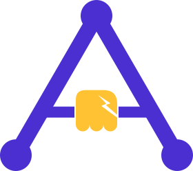

<p align="center">
  <picture>
    <source media="(prefers-color-scheme: dark)" srcset="brand/affordkit-dark.svg">
    
  </picture>
</p>

<h1 align="center">AffordKit</h1>

<p align="center">Your app's UI, for AI agents to see and use.</p>

AffordKit turns your app's screen into a small tree an agent reads: each control, what it shows, its state, and what can be
done to it. The agent answers with calls (press, type, scroll, go to a page) that your app runs under its own rules, and gets
back what they changed on screen.

## Pick your platform

- **Flutter**: [`flutter/README.md`](flutter/README.md) (`flutter pub add affordkit`)
- **JavaScript / TypeScript**, for any web framework and for the agent's side on a server:
  [`js/README.md`](js/README.md) (`npm install affordkit`)

A Flutter app with its model on a TypeScript server uses both: the Flutter package in the app, the npm package on the server.
They speak the same JSON.

## Let your coding agent add it

[`skills/affordkit`](skills/affordkit/SKILL.md) is an agent skill: it walks a coding agent through adding AffordKit to an
existing project, from installing it and putting the controls into the tree to deciding what the agent may do and connecting it
to an agent backend. Install it, then ask your agent to "add AffordKit to this app".

**Claude Code**, as a plugin from this repository:

```text
/plugin install affordkit --marketplace momomoink/affordkit
```

On Claude Code before 2.1.275, add the marketplace first:

```text
/plugin marketplace add momomoink/affordkit
/plugin install affordkit@affordkit
```

The skill is then `/affordkit:affordkit`, and Claude also uses it by itself when you ask for AffordKit.

**Claude Code, without the plugin:** copy `skills/affordkit/` to `~/.claude/skills/affordkit/` (all your projects) or to
`.claude/skills/affordkit/` in one project.

**claude.ai:** zip the `skills/affordkit/` folder and upload it in Settings (Features / Capabilities, under Skills). This needs a
plan with code execution enabled.

**Other agents:** the skill follows the open [Agent Skills](https://agentskills.io) format. Copy the folder to wherever your agent
loads skills from; see its own documentation for the path.

## Docs

[`docs/`](docs/README.md): concepts, getting started for each platform, what to expose to the agent, connecting an agent, and
the protocol.

## Contributing

- `js/`: `npm install`, `npm test`, `npm run typecheck`, `npm run build`.
- `flutter/`: `flutter test`, `flutter analyze`.
- Keep `js/src/protocol.ts` and `flutter/lib/src/protocol.dart` in step.
- After changing `docs/`, run `node scripts/sync-skill.mjs`: the skill's references are copies of the docs.

The logo is in [`brand/`](brand): `affordkit.svg` for light grounds, `affordkit-dark.svg` for dark ones. MIT license.
