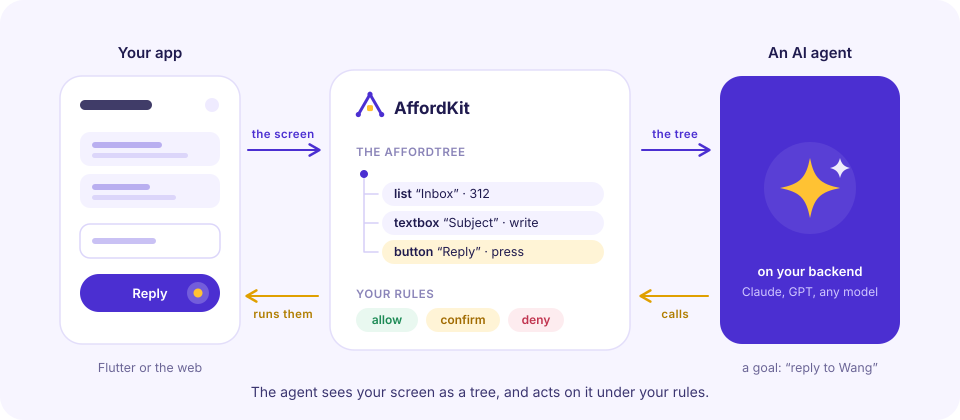

<p align="center">
  <picture>
    <source media="(prefers-color-scheme: dark)" srcset="brand/affordkit-dark.svg">
    
  </picture>
</p>

<h1 align="center">AffordKit</h1>

<p align="center">Your app's UI, for AI agents to see and use.</p>

AffordKit is a frontend library: it lets an AI agent on your backend use your app's UI the way a person would. Open that mail,
press Reply, type the answer; the user watches it happen, on their own screen.

<p align="center">
  <picture>
    <source media="(prefers-color-scheme: dark)" srcset="brand/concept-dark.svg">
    
  </picture>
</p>

## Why

- **Not pixels.** The agent doesn't read screenshots and guess where to click. It gets the screen as a few lines of text, each
  control with what it is, what it shows and what can be done to it; fast, cheap, and it doesn't miss.
- **Not a second API.** What the agent does goes through the same buttons, fields and pages the user has, with the same checks.
  There is nothing extra to build and keep in step.
- **The user stays in charge.** You decide what it may just do, what needs the user's yes first, and what is theirs alone (send,
  pay). They see each step, can stop it, and can keep using the app meanwhile: the agent is told what they did.

## How it works

**1. The screen becomes an AffordTree.** Only the controls that mean something, never their content until it is read:

```
Route: /message/42 — can go back
[w4 key=thread.reply] button "Reply" — press
[w7 key=thread.body] text "Message" — read
[w9 key=compose.send] button "Send" — press(deny)
```

**2. The agent answers with calls:** press, type, scroll, go to a page, or a tool of your app's.

**3. Your app runs them under your rules,** and the agent gets back what changed, not the whole tree again:

```
Done.

The screen changed:
Now at /reply/42 (was /message/42) — can go back.
+ [w12 key=compose.body] textbox "Body" — read, write, append, clear
+ [w13 key=compose.send] button "Send" — press(deny)
```

It goes on like that, step by step, until the goal is done.

## A taste

Most controls are found by themselves. Name the ones that matter, and say what the agent may do:

```dart
// Flutter
ElevatedButton(onPressed: send, child: const Text('Send'))
    .afford('Send', key: 'compose.send', policy: Policy.deny);
```

```html
<!-- Web, any framework -->
<button data-afford-key="compose.send" data-afford-policy="deny">Send</button>
```

The app answers the agent's requests over the channel it already has; where the model runs, `AffordRemote` turns them into its
tools:

```ts
import { AffordRemote, anthropicTools, anthropicResult } from 'affordkit';

const ui = new AffordRemote({ send: (request) => askTheApp(request) }); // the app: kit.answer(request)
const res = await client.messages.create({ model, max_tokens, messages, tools: anthropicTools(ui.tools()) });
```

OpenAI, MCP and other loops are covered too.

## What it takes care of

- **Long lists:** one node with a preview; the agent searches, fetches and scrolls to the entry it wants.
- **Pages:** the agent knows where the user is, can go to a page, or look at one before going.
- **Your rules:** `allow`, `confirm` (the user says yes first), `deny` (the user's own act). Passwords are never read.
- **Waiting for the screen:** each step answers once what it set off (a search, a page loading) has shown; your app says when.
- **The user's own hands:** what they do while the agent works goes to it, with the screen as it is after.
- **The user leaving:** the agent finishes another way and leaves a handoff, a way back to what it did.

## Pick your platform

- **Flutter**: [`flutter/README.md`](flutter/README.md) (`flutter pub add affordkit`)
- **JavaScript / TypeScript**, for any web framework and for the agent's side on a server:
  [`js/README.md`](js/README.md) (`npm install affordkit`)

A Flutter app with its model on a TypeScript server uses both: the Flutter package in the app, the npm package on the server.
They speak the same JSON.

## Let your coding agent add it

[`skills/affordkit`](skills/affordkit/SKILL.md) is an agent skill: it walks a coding agent through adding AffordKit to an
existing project, from installing it and putting the controls into the tree to deciding what the agent may do and connecting it
to an agent backend. Install it, then ask your agent to "add AffordKit to this app".

**Claude Code**, as a plugin from this repository:

```text
/plugin install affordkit --marketplace momomoink/affordkit
```

On Claude Code before 2.1.275, add the marketplace first:

```text
/plugin marketplace add momomoink/affordkit
/plugin install affordkit@affordkit
```

The skill is then `/affordkit:affordkit`, and Claude also uses it by itself when you ask for AffordKit.

**Claude Code, without the plugin:** copy `skills/affordkit/` to `~/.claude/skills/affordkit/` (all your projects) or to
`.claude/skills/affordkit/` in one project.

**claude.ai:** zip the `skills/affordkit/` folder and upload it in Settings (Features / Capabilities, under Skills). This needs a
plan with code execution enabled.

**Other agents:** the skill follows the open [Agent Skills](https://agentskills.io) format. Copy the folder to wherever your agent
loads skills from; see its own documentation for the path.

## Docs

[`docs/`](docs/README.md): a set per platform ([`docs/flutter`](docs/flutter/README.md), [`docs/js`](docs/js/README.md)), each with concepts, getting started, what to expose to the agent, connecting an agent and
handoffs (for when the user has left the app); and the [protocol](docs/protocol.md).

## Contributing

- `js/`: `npm install`, `npm test`, `npm run typecheck`, `npm run build`.
- `flutter/`: `flutter test`, `flutter analyze`.
- Keep `js/src/protocol.ts` and `flutter/lib/src/protocol.dart` in step.
- After changing `docs/`, run `node scripts/sync-skill.mjs`: the skill's references are copies of the docs.

The logo and the picture above are in [`brand/`](brand): `affordkit.svg` and `concept.svg` for light grounds, the `-dark` ones for
dark grounds. MIT license.
